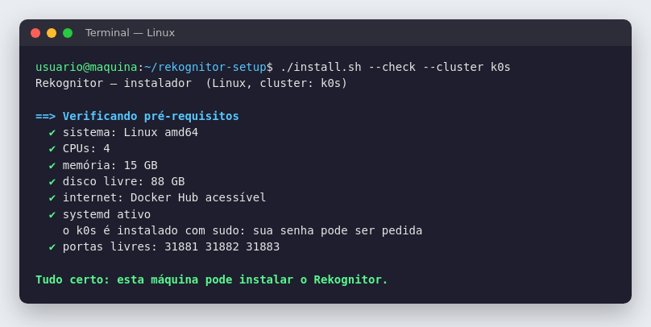
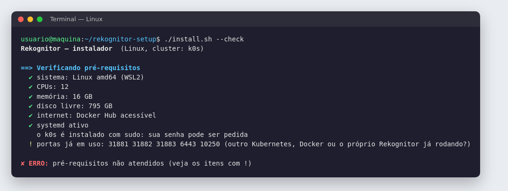
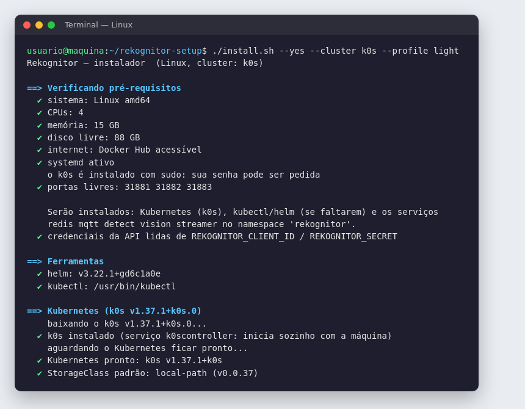
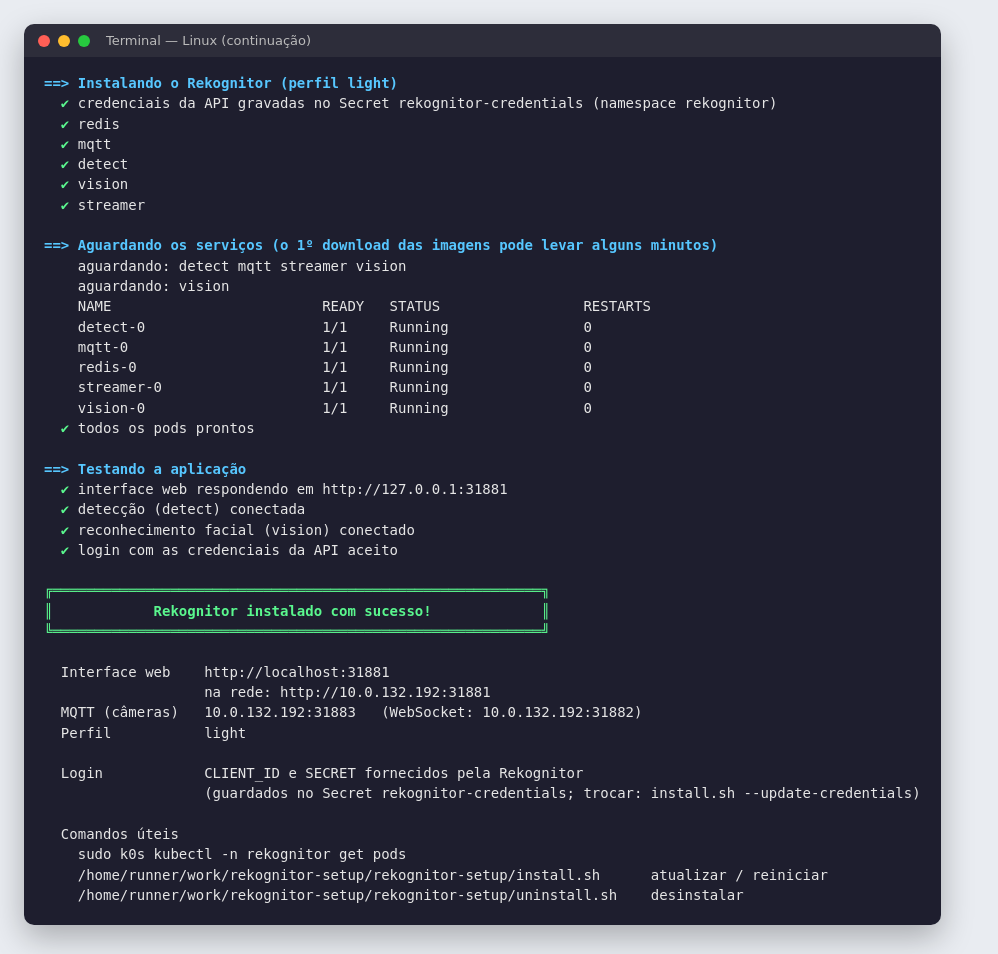
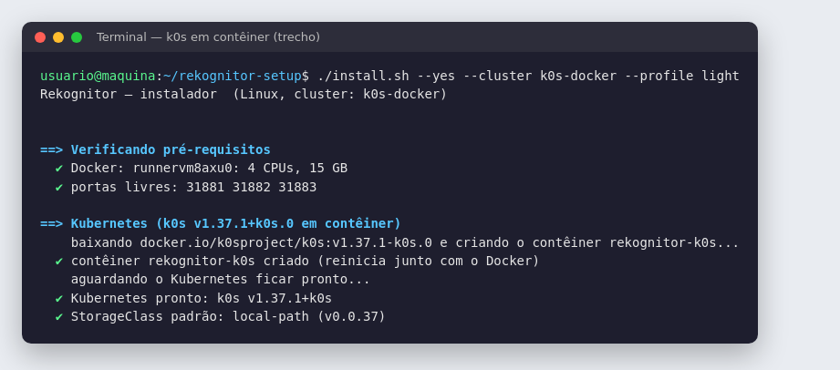
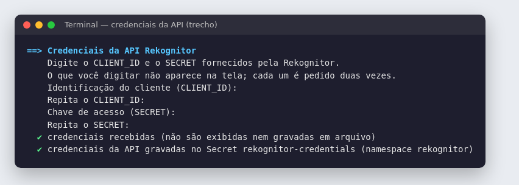
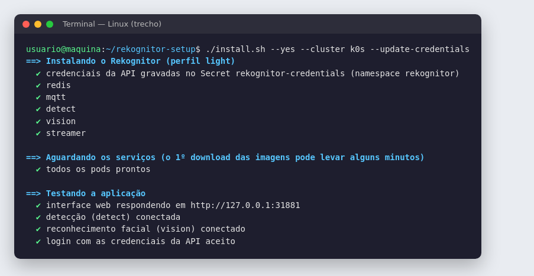
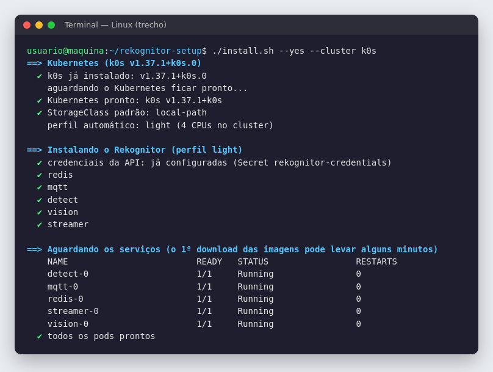
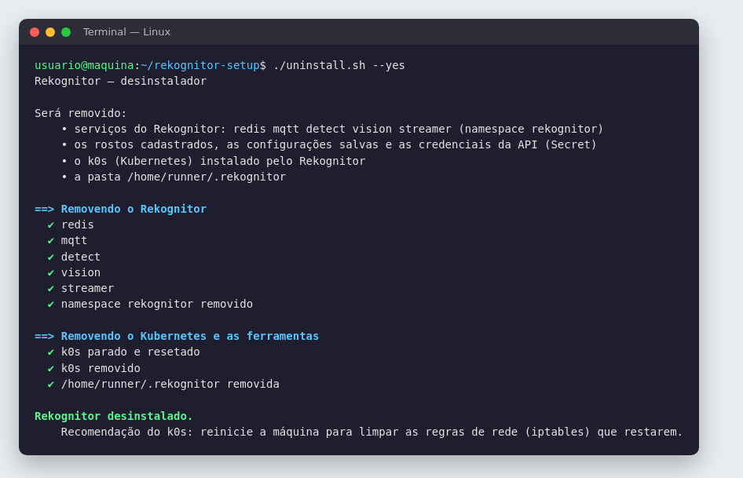

# Manual de instalação do Rekognitor

Este manual mostra como instalar, atualizar e desinstalar o Rekognitor em **Windows**, **Linux** e **macOS**, usando os instaladores deste repositório.

> **Sobre as imagens:** todas as imagens deste manual são saídas reais dos instaladores e da interface do Rekognitor. As instalações completas foram feitas num Ubuntu 24.04 com 4 CPUs (máquina de testes do CI), com credenciais de teste passadas por variáveis de ambiente. As telas do próprio Windows (UAC, SmartScreen) são descritas em texto.

## Sumário

1. [O que é instalado](#1-o-que-é-instalado)
2. [Requisitos](#2-requisitos)
3. [Baixar o instalador](#3-baixar-o-instalador)
4. [Instalação no Windows](#4-instalação-no-windows)
5. [Instalação no Linux](#5-instalação-no-linux)
6. [Instalação no macOS](#6-instalação-no-macos)
7. [Primeiro acesso](#7-primeiro-acesso)
8. [Conectar câmeras e sistemas (MQTT)](#8-conectar-câmeras-e-sistemas-mqtt)
9. [Atualizar, reiniciar e verificar](#9-atualizar-reiniciar-e-verificar)
10. [Desinstalar](#10-desinstalar)
11. [Opções avançadas](#11-opções-avançadas)
12. [Solução de problemas](#12-solução-de-problemas)
13. [Onde ficam os arquivos](#13-onde-ficam-os-arquivos)

---

## 1. O que é instalado

O instalador cria um Kubernetes de **um único nó** na própria máquina e instala nele os serviços do Rekognitor, no namespace `rekognitor`:

| Serviço | Função |
| --- | --- |
| **streamer** | Interface web e API. Lê as câmeras (RTSP) e publica as detecções |
| **detect** | Detecção de objetos (RT-DETR) |
| **vision** | Reconhecimento facial e base de rostos cadastrados |
| **mqtt** | Broker MQTT para onde as detecções são publicadas (`cameras/<id>`) |
| **redis** | Guarda as configurações feitas pela interface |

O Kubernetes é o **k0s**, na **mesma versão em todos os sistemas** (v1.37.1+k0s.0). Muda só onde ele roda:

| Sistema | Onde o k0s roda |
| --- | --- |
| Linux | direto na máquina, como serviço do systemd (`k0scontroller`) |
| Windows 10/11 | direto numa distribuição WSL2 exclusiva, chamada `Rekognitor` |
| macOS | no contêiner oficial do k0s (`k0sproject/k0s`), sobre o Docker Desktop ou o Colima (gratuito, instalado pelo Homebrew). O macOS não tem kernel Linux, então o k0s precisa de um contêiner |

Os serviços ficam acessíveis pelas mesmas portas em todos os sistemas:

| Porta | Uso |
| --- | --- |
| 31881 | interface web e API |
| 31883 | MQTT (câmeras e integrações) |
| 31882 | MQTT por WebSocket (usado pela interface) |

O instalador anota tudo o que criou. O desinstalador remove **somente** essas coisas: um Kubernetes ou Docker que já existia na máquina continua lá.

## 2. Requisitos

| | Mínimo | Recomendado |
| --- | --- | --- |
| CPU | 2 núcleos | 4 núcleos ou mais (com 6 ou mais, o detect roda com 3 a 5 réplicas) |
| Memória | 4 GB (Windows: 6 GB) | 8 GB ou mais |
| Disco livre | 15 GB (Windows: 20 GB) | 30 GB |
| Internet | acesso ao Docker Hub (`registry-1.docker.io`) e ao GitHub | |
| Portas livres | 31881, 31882, 31883 (no Linux e no Windows, também 6443 e 10250, usadas pelo k0s) | |

**Credenciais da API:** tenha em mãos o **CLIENT_ID** e o **SECRET** fornecidos pela Rekognitor para o seu contrato. O instalador pede os dois durante a instalação.

Requisitos de cada sistema:

- **Windows:** Windows 10 versão 2004 (build 19041) ou mais novo, ou Windows 11. A virtualização (Intel VT-x / AMD-V) precisa estar habilitada na BIOS/UEFI. É preciso um usuário com permissão de administrador.
- **Linux:** distribuição com systemd (Ubuntu 20.04+, Debian 11+, RHEL/Rocky/Alma 8+, etc.), `curl`, e acesso ao `sudo` (ou rodar como root). x86_64 ou arm64.
- **macOS:** macOS 12 ou mais novo, Apple Silicon ou Intel. Precisa do [Docker Desktop](https://www.docker.com/products/docker-desktop/) **ou** do [Homebrew](https://brew.sh). Com o Homebrew, o instalador instala o Colima, que é gratuito.

Antes de instalar, dá para verificar a máquina sem instalar nada (veja `--check` / `-Check` nas seções de cada sistema).

## 3. Baixar o instalador

**Opção A, download do ZIP (mais simples):**

1. Acesse <https://github.com/Rekognitor/rekognitor-setup>.
2. Clique em **Code → Download ZIP**.
3. Extraia o ZIP numa **pasta local**, por exemplo `C:\Rekognitor` no Windows ou `~/rekognitor-setup` no Linux/macOS.
   No Windows, não extraia em pasta de rede nem rode direto de dentro do ZIP.

**Opção B, git:**

```bash
git clone https://github.com/Rekognitor/rekognitor-setup.git
cd rekognitor-setup
```

**Opção C, uma linha (só Linux/macOS):**

```bash
curl -fsSL https://raw.githubusercontent.com/Rekognitor/rekognitor-setup/main/install.sh | bash
```

A opção C baixa o instalador para `~/.rekognitor/src` e o executa de lá.

Conteúdo da pasta:

```
install.sh              instalador Linux / macOS
uninstall.sh            desinstalador Linux / macOS
install-windows.cmd     instalador Windows (duplo clique)
uninstall-windows.cmd   desinstalador Windows (duplo clique)
charts/                 serviços do Rekognitor (Helm charts)
values/                 perfis de recursos (light / full)
docs/                   este manual
```

## 4. Instalação no Windows

### 4.1 Verificar a máquina (opcional)

Abra o **Prompt de Comando** na pasta extraída e rode:

```bat
install-windows.cmd -Check
```


Se aparecer algum item com `[!]`, veja a [Solução de problemas](#12-solução-de-problemas).

### 4.2 Instalar

1. Dê **duplo clique** em `install-windows.cmd`.
   - Se o Windows mostrar **"O Windows protegeu o computador"** (SmartScreen), clique em **Mais informações → Executar assim mesmo**. Para evitar o aviso, antes de extrair clique com o botão direito no ZIP → **Propriedades** → marque **Desbloquear** → **OK**.
2. Na janela **Controle de Conta de Usuário**, clique em **Sim**. O instalador precisa de permissão de administrador.
3. O instalador verifica a máquina e mostra o que vai fazer. Digite `s` e Enter para continuar.
4. Digite o **CLIENT_ID** e o **SECRET** fornecidos pela Rekognitor, cada um duas vezes. O que você digita **não aparece na tela** (veja a [seção 7.1](#71-credenciais-da-api)).
5. **Se o WSL não estiver instalado**, o instalador o instala e pede para **reiniciar o Windows**. Depois do login, a instalação **continua sozinha**: aceite de novo o pedido de administrador.
6. O instalador então:
   - baixa o Ubuntu 24.04 (cerca de 350 MB, com o checksum conferido) e cria a distribuição WSL `Rekognitor`;
   - cria a tarefa agendada **Rekognitor**, que mantém o Rekognitor ligado sempre que você faz login no Windows;
   - instala o k0s e os serviços. O primeiro download das imagens leva de **5 a 15 minutos**, dependendo da internet.
7. No final, aparece o resumo com o endereço da interface, o navegador abre a interface, e é criado o atalho **Rekognitor** na Área de Trabalho. As credenciais não são exibidas.

> As suas outras distribuições WSL e o arquivo `.wslconfig` **não são alterados**.

### 4.3 Acesso pela rede local (outras máquinas)

Por padrão, a interface só é acessível pelo próprio computador (`http://localhost:31881`). Para liberar o acesso pela rede, para outros computadores e para as câmeras publicarem no MQTT, instale com:

```bat
install-windows.cmd -AllowLan
```

Isso cria regras no Firewall do Windows (grupo **Rekognitor**) para as portas 31881, 31882 e 31883. Se o Rekognitor já estiver instalado, rodar esse comando de novo só aplica a mudança.

### 4.4 Parâmetros do instalador Windows

| Parâmetro | Efeito |
| --- | --- |
| `-Check` | só verifica os pré-requisitos |
| `-AllowLan` | libera o acesso pela rede local |
| `-Profile light` / `-Profile full` | força o perfil de recursos (padrão: automático) |
| `-Yes` | não pede confirmações |
| `-Timeout 1800` | espera máxima pelos serviços, em segundos (padrão: 1200) |

## 5. Instalação no Linux

### 5.1 Verificar a máquina (opcional)

```bash
./install.sh --check
```



A verificação para se alguma porta estiver ocupada, por exemplo por outro Kubernetes já instalado:



### 5.2 Instalar

```bash
cd rekognitor-setup
./install.sh
```

1. Confirme com `s`. A senha do `sudo` pode ser pedida, porque o k0s é instalado como serviço do sistema.
2. Digite o **CLIENT_ID** e o **SECRET** fornecidos pela Rekognitor, cada um duas vezes. O que você digita não aparece na tela (veja a [seção 7.1](#71-credenciais-da-api)).
3. O instalador:
   - baixa o **k0s** v1.37.1+k0s.0, conferindo o checksum, e o instala como serviço `k0scontroller` do systemd (controlador e worker na mesma máquina), que inicia sozinho com a máquina;
   - instala o `local-path-provisioner` como StorageClass padrão, para guardar os rostos cadastrados;
   - baixa o `kubectl` e o `helm` para `~/.rekognitor/bin` se eles não existirem, conferindo os checksums;
   - grava as credenciais num Secret do k0s, instala os serviços e espera todos ficarem prontos;
   - testa a interface, a conexão com o detect e o vision e o login com as credenciais.
4. No final, aparece o resumo com o endereço da interface. As credenciais não são exibidas.

Uma instalação completa, do início. Nela, as credenciais vieram das variáveis de ambiente (instalação automatizada); numa instalação interativa, no lugar dessa linha aparece o pedido mostrado na [seção 7.1](#71-credenciais-da-api):



E a continuação, com os serviços, o teste da aplicação e o resumo final:



No Windows, o instalador roda exatamente esse mesmo processo dentro da distribuição WSL `Rekognitor`.

Para consultar o cluster, use o `kubectl` do próprio k0s, com sudo:

```bash
sudo k0s kubectl -n rekognitor get pods
```

O acesso de administrador ao k0s fica restrito a quem tem `sudo`: o instalador não deixa nenhum kubeconfig de administrador na sua pasta, e não mexe no seu `~/.kube/config`.

Todas as opções:


### 5.3 Acesso pela rede

No Linux, as portas já ficam acessíveis pela rede. Se a máquina usa firewall (ufw, firewalld), libere as portas:

```bash
# ufw (Ubuntu)
sudo ufw allow 31881:31883/tcp
# firewalld (RHEL/Rocky/Alma)
sudo firewall-cmd --permanent --add-port=31881-31883/tcp && sudo firewall-cmd --reload
```

## 6. Instalação no macOS

1. Tenha o **Docker Desktop** aberto, **ou** o **Homebrew** instalado (<https://brew.sh>).
2. No Terminal:

   ```bash
   cd rekognitor-setup
   ./install.sh
   ```

3. Confirme com `s` e digite o **CLIENT_ID** e o **SECRET** fornecidos pela Rekognitor (não aparecem na tela). O instalador:
   - usa o Docker que estiver rodando. Se não houver nenhum, instala o **Colima** e o cliente `docker` pelo Homebrew e cria a VM `rekognitor` (4 CPUs, 8 GB e 40 GB de disco; ajustável com `COLIMA_CPU`, `COLIMA_MEMORY` e `COLIMA_DISK`);
   - baixa `kubectl` e `helm` para `~/.rekognitor/bin`, conferindo os checksums;
   - cria o contêiner `rekognitor-k0s` com o k0s v1.37.1+k0s.0 (imagem oficial `k0sproject/k0s`), com as portas 31881–31883 publicadas no Mac, e instala os serviços.

O contêiner reinicia junto com o Docker. A criação do k0s em contêiner fica assim; daí em diante, a saída é igual à do Linux:



No Docker Desktop, reserve pelo menos **4 CPUs e 8 GB** em *Settings → Resources*.

> **Depois de reiniciar o Mac**, abra o Docker Desktop (o Rekognitor volta sozinho). Se usar o Colima, rode `./install.sh` de novo: ele religa a VM e o k0s sem reinstalar nada.

## 7. Primeiro acesso

1. Abra **<http://localhost:31881>**. No Windows, use também o atalho **Rekognitor** da Área de Trabalho. Pela rede, use `http://<IP-da-máquina>:31881`.
2. Na tela de login, preencha:
   - **Identificação do cliente:** o seu `CLIENT_ID`;
   - **Chave de acesso:** o seu `SECRET`.


### 7.1 Credenciais da API

O **CLIENT_ID** e o **SECRET** são emitidos pela Rekognitor para cada cliente. O instalador **não gera** credenciais e as protege assim:

- **Pedidas sem eco:** o instalador pede cada valor duas vezes, para evitar erro de digitação, e nada do que você digita aparece na tela.

  

- **Não aparecem em lugar nenhum:** os valores não são exibidos no resumo, não aparecem em linhas de comando (onde outros usuários da máquina poderiam vê-los) e não são gravados em arquivos.
- **Guardadas num Secret do Kubernetes:** os valores vão direto para o Secret `rekognitor-credentials`, no namespace `rekognitor` do k0s. O streamer lê o Secret ao iniciar, então as credenciais também não aparecem na configuração dos serviços.
- **Só administradores do k0s leem:** no Linux, quem tem `sudo`. No Windows, o seu usuário, que é o dono da distribuição `Rekognitor`. No macOS, quem tem acesso ao Docker.
- **Login conferido:** no fim da instalação, o instalador confere se o streamer aceita as credenciais.

**Trocar as credenciais** (por exemplo, quando a Rekognitor emitir novas): rode o instalador com a opção abaixo. Ele pede os novos valores, atualiza o Secret, reinicia o streamer e confere o login.

```bash
./install.sh --update-credentials                 # Linux / macOS
```

```bat
wsl -d Rekognitor bash /opt/rekognitor/install.sh --update-credentials
```



**Instalação automatizada** (sem ninguém digitando): defina as variáveis de ambiente `REKOGNITOR_CLIENT_ID` e `REKOGNITOR_SECRET` antes de rodar o instalador. No Windows, defina as variáveis na mesma janela antes de rodar o `install-windows.cmd`. Elas são repassadas ao WSL pelo ambiente, e não pela linha de comando.

## 8. Conectar câmeras e sistemas (MQTT)

- As câmeras são cadastradas na interface, com o endereço RTSP de cada uma. O Rekognitor é quem se conecta às câmeras, então elas precisam estar acessíveis a partir desta máquina.
- As detecções são publicadas no broker MQTT, no tópico `cameras/<id-da-câmera>`:
  - MQTT/TCP: `<IP-da-máquina>:31883`
  - MQTT por WebSocket: `<IP-da-máquina>:31882`

  Teste com o `mosquitto_sub`:

  ```bash
  mosquitto_sub -h <IP-da-máquina> -p 31883 -t 'cameras/#' -v
  ```

- O broker aceita conexões **anônimas**. Não exponha a porta 31883 para a internet.
- Há um painel do broker (usuário `admin`, senha `rekognitor-admin`), acessível só de dentro do cluster:

  ```bash
  sudo k0s kubectl -n rekognitor port-forward svc/mqtt-dashboard 8080:8080
  # abra http://localhost:8080/dashboard/
  ```

## 9. Atualizar, reiniciar e verificar

**Atualizar** para a versão mais nova:

1. Baixe o repositório de novo (ZIP ou `git pull`).
2. Rode o instalador de novo: `./install.sh` ou `install-windows.cmd`.

A atualização mantém as credenciais (não são pedidas de novo), os rostos cadastrados e as configurações. As imagens dos serviços usam a tag `latest`, então cada reinstalação baixa a versão mais recente. O k0s já instalado e as credenciais já gravadas são reaproveitados:



**Verificar** se está tudo rodando:

| Sistema | Comando |
| --- | --- |
| Linux | `sudo k0s kubectl -n rekognitor get pods` |
| Windows | `wsl -d Rekognitor k0s kubectl -n rekognitor get pods` |
| macOS | `docker exec rekognitor-k0s k0s kubectl -n rekognitor get pods` |

Nos exemplos abaixo, `sudo k0s kubectl` é a forma do Linux. No Windows e no macOS, use o comando equivalente da tabela.

Todos os pods devem aparecer como `Running` e `1/1`.

**Reiniciar um serviço**, por exemplo o streamer:

```bash
sudo k0s kubectl -n rekognitor rollout restart statefulset/streamer
```

**Ligar e desligar:**

- Linux: o serviço `k0scontroller` liga com a máquina (`sudo k0s stop` / `sudo k0s start`).
- macOS: o contêiner liga com o Docker; para desligar, `docker stop rekognitor-k0s` e, se usar o Colima, `colima stop rekognitor`. `./install.sh` religa tudo.
- Windows: a tarefa **Rekognitor** liga tudo no login. Para desligar até o próximo login: `schtasks /End /TN Rekognitor` e depois `wsl --terminate Rekognitor`.

## 10. Desinstalar

> **Atenção:** a desinstalação apaga os **rostos cadastrados** e as configurações feitas na interface.

**Windows:** dê duplo clique em `uninstall-windows.cmd`, aceite o pedido de administrador e confirme com `s`. São removidos a distribuição WSL `Rekognitor`, a tarefa agendada, as regras de firewall, os redirecionamentos de porta, o atalho e `C:\ProgramData\Rekognitor`. O WSL continua instalado. Para removê-lo também, use **Configurações → Aplicativos → Subsistema do Windows para Linux**.

**Linux / macOS:**

```bash
./uninstall.sh
```

São removidos os serviços, o k0s (`k0s reset`, se foi o instalador que o instalou), o contêiner `rekognitor-k0s` e o volume dele, a VM Colima e os pacotes Homebrew que o instalador adicionou, e a pasta `~/.rekognitor`. No Linux, o k0s recomenda reiniciar a máquina depois, para limpar regras de rede que restarem.



Para remover **só o Rekognitor** e manter o Kubernetes:

```bash
./uninstall.sh --keep-cluster
```

## 11. Opções avançadas

**Perfis de recursos:** o perfil é escolhido automaticamente pela quantidade de CPUs do cluster.

| Perfil | Quando | detect |
| --- | --- | --- |
| `light` | menos de 6 CPUs | 1 réplica, sem autoscaling |
| `full` | 6 CPUs ou mais | 3 a 5 réplicas, com autoscaling |

Para forçar um perfil: `./install.sh --profile full` ou `install-windows.cmd -Profile full`.

**Configurações próprias:** crie `~/.rekognitor/values/<serviço>.yaml` (no Windows, dentro da distribuição: `/root/.rekognitor/values/`). O instalador aplica esse arquivo em toda instalação e atualização. Por exemplo, para exigir login na API:

```yaml
# ~/.rekognitor/values/streamer.yaml
env:
  REQUIRE_AUTH: "1"
```

Depois rode `./install.sh` de novo.

**Cluster Kubernetes já existente:** com `KUBECONFIG` apontando para o cluster, rode `./install.sh --cluster existing`. O cluster precisa de um StorageClass padrão, para o PVC de rostos, e de um CNI que aplique NetworkPolicy.

**Docker Hub com login:** para evitar o limite de downloads anônimos, rode com `DOCKERHUB_USERNAME=... DOCKERHUB_TOKEN=... ./install.sh`.

**Versões:** o padrão é o k0s v1.37.1+k0s.0, a versão em que os serviços são validados. Dá para trocar com as variáveis `K0S_VERSION` (ex.: `v1.37.2+k0s.1`), `K0S_IMAGE` (macOS), `HELM_VERSION` e `LOCAL_PATH_VERSION`.

## 12. Solução de problemas

| Sintoma | Causa provável / solução |
| --- | --- |
| `portas já em uso` | Outro Kubernetes, Docker Desktop ou um Rekognitor antigo está usando as portas. Pare ou remova o outro serviço. No Windows, verifique outras distribuições WSL com Kubernetes (`wsl -l -v`). |
| `virtualização desabilitada` (Windows) | Habilite Intel VT-x / AMD-V na BIOS/UEFI do computador. |
| `systemd não está ativo` (Linux) | O k0s precisa do systemd. Em WSL próprio, adicione `[boot]` `systemd=true` em `/etc/wsl.conf`. |
| `serviços não ficaram prontos em 1200s` | Normalmente é um download lento ou bloqueado das imagens. Rode o instalador de novo, que continua de onde parou, ou aumente com `--timeout 2400`. Veja o motivo com `sudo k0s kubectl -n rekognitor get pods` e `sudo k0s kubectl -n rekognitor describe pod <nome>`. |
| Pod em `ImagePullBackOff` | Sem acesso ao Docker Hub, ou o limite de downloads foi atingido (use `DOCKERHUB_USERNAME`/`DOCKERHUB_TOKEN`). |
| Pod em `Pending` | Faltam CPU ou memória. Use `--profile light` ou dê mais recursos ao Docker/Colima. |
| Windows: `http://localhost:31881` não abre | Aguarde 1 minuto depois do login. Confira se a tarefa **Rekognitor** está "Em execução" no Agendador de Tarefas. Se não estiver, reinicie o Windows. |
| Outras máquinas não acessam | Windows: reinstale com `-AllowLan`. Linux: libere as portas no firewall (seção 5.3). macOS: libere o acesso em *Ajustes → Rede → Firewall*. |
| `o streamer recusou as credenciais` | O CLIENT_ID ou o SECRET foi digitado errado. Rode de novo com `--update-credentials` (seção 7.1). |
| Perdi as credenciais | Elas não ficam gravadas em arquivo. Peça à Rekognitor e troque com `--update-credentials`. |
| `sem terminal para pedir as credenciais` | O instalador rodou sem terminal (automação). Defina `REKOGNITOR_CLIENT_ID` e `REKOGNITOR_SECRET`. |

Para pedir suporte, envie a saída de:

```bash
sudo k0s kubectl -n rekognitor get pods -o wide
sudo k0s kubectl -n rekognitor get events --sort-by=.lastTimestamp | tail -30
```

## 13. Onde ficam os arquivos

| | Linux / macOS | Windows |
| --- | --- | --- |
| Estado da instalação | `~/.rekognitor/state` | `C:\ProgramData\Rekognitor\state.json` |
| Credenciais da API | Secret `rekognitor-credentials` no k0s (não ficam em arquivo) | Secret `rekognitor-credentials` no k0s, dentro da distribuição |
| Acesso de administrador ao k0s | `sudo k0s kubectl` (macOS: `docker exec rekognitor-k0s k0s kubectl`) | `wsl -d Rekognitor k0s kubectl` |
| Ferramentas baixadas | `~/.rekognitor/bin` | dentro da distribuição |
| Configurações próprias | `~/.rekognitor/values/` | `/root/.rekognitor/values/` (na distribuição) |
| Distribuição WSL | — | `C:\ProgramData\Rekognitor\wsl` |
| Rostos cadastrados | volume do serviço vision, dentro do Kubernetes | volume do serviço vision, dentro da distribuição |
