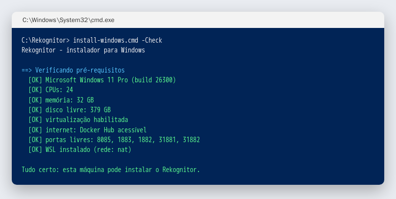
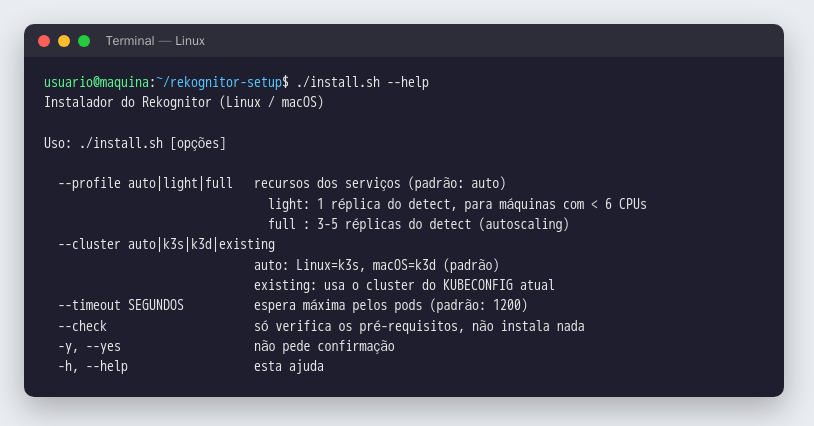
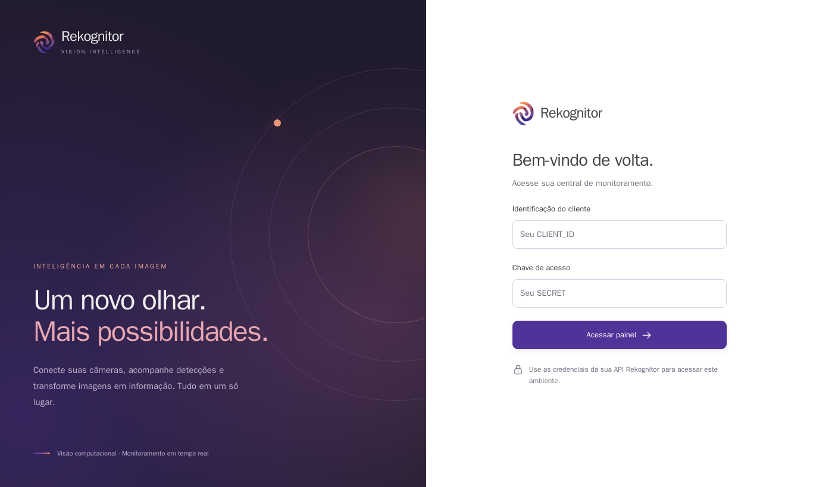

# Manual de instalação do Rekognitor

Este manual mostra como instalar, atualizar e desinstalar o Rekognitor em **Windows**, **Linux** e **macOS**, usando os instaladores deste repositório.

> **Sobre as imagens:** todas as imagens deste manual são saídas reais dos instaladores e da interface do Rekognitor. As telas do próprio Windows (UAC, SmartScreen) são descritas em texto.

## Sumário

1. [O que é instalado](#1-o-que-é-instalado)
2. [Requisitos](#2-requisitos)
3. [Baixar o instalador](#3-baixar-o-instalador)
4. [Instalação no Windows](#4-instalação-no-windows)
5. [Instalação no Linux](#5-instalação-no-linux)
6. [Instalação no macOS](#6-instalação-no-macos)
7. [Primeiro acesso](#7-primeiro-acesso)
8. [Conectar câmeras e sistemas (MQTT)](#8-conectar-câmeras-e-sistemas-mqtt)
9. [Atualizar, reiniciar e verificar](#9-atualizar-reiniciar-e-verificar)
10. [Desinstalar](#10-desinstalar)
11. [Opções avançadas](#11-opções-avançadas)
12. [Solução de problemas](#12-solução-de-problemas)
13. [Onde ficam os arquivos](#13-onde-ficam-os-arquivos)

---

## 1. O que é instalado

O instalador cria um Kubernetes de **um único nó** na própria máquina e instala nele os serviços do Rekognitor, no namespace `rekognitor`:

| Serviço | Função |
| --- | --- |
| **streamer** | Interface web e API. Lê as câmeras (RTSP) e publica as detecções |
| **detect** | Detecção de objetos (modelos RT-DETR e YOLO) |
| **vision** | Reconhecimento facial e base de rostos cadastrados |
| **mqtt** | Broker MQTT para onde as detecções são publicadas (`cameras/<id>`) |
| **redis** | Guarda as configurações feitas pela interface |

O Kubernetes muda conforme o sistema:

| Sistema | Kubernetes | Como roda |
| --- | --- | --- |
| Windows 10/11 | k3s | dentro de uma distribuição WSL2 exclusiva, chamada `Rekognitor` |
| Linux | k3s | nativo, como serviço do systemd |
| macOS | k3d (k3s em contêiner) | sobre o Docker Desktop, ou sobre o Colima (gratuito, instalado pelo Homebrew) |

O instalador anota tudo o que criou. O desinstalador remove **somente** essas coisas: um Kubernetes ou Docker que já existia na máquina continua lá.

## 2. Requisitos

| | Mínimo | Recomendado |
| --- | --- | --- |
| CPU | 2 núcleos | 4 núcleos ou mais (com 6 ou mais, o detect roda com 3 a 5 réplicas) |
| Memória | 4 GB (Windows: 6 GB) | 8 GB ou mais |
| Disco livre | 15 GB (Windows: 20 GB) | 30 GB |
| Internet | acesso ao Docker Hub (`registry-1.docker.io`) e ao GitHub | |
| Portas livres | 8085, 1883, 1882, 31881, 31882 | |

Requisitos de cada sistema:

- **Windows:** Windows 10 versão 2004 (build 19041) ou mais novo, ou Windows 11. A virtualização (Intel VT-x / AMD-V) precisa estar habilitada na BIOS/UEFI. É preciso um usuário com permissão de administrador.
- **Linux:** distribuição com systemd (Ubuntu 20.04+, Debian 11+, RHEL/Rocky/Alma 8+, etc.), `curl`, e acesso ao `sudo` (ou rodar como root). x86_64 ou arm64.
- **macOS:** macOS 12 ou mais novo, Apple Silicon ou Intel. Precisa do [Docker Desktop](https://www.docker.com/products/docker-desktop/) **ou** do [Homebrew](https://brew.sh). Com o Homebrew, o instalador instala o Colima, que é gratuito.

Antes de instalar, dá para verificar a máquina sem instalar nada (veja `--check` / `-Check` nas seções de cada sistema).

## 3. Baixar o instalador

**Opção A, download do ZIP (mais simples):**

1. Acesse <https://github.com/Rekognitor/rekognitor-setup>.
2. Clique em **Code → Download ZIP**.
3. Extraia o ZIP numa **pasta local**, por exemplo `C:\Rekognitor` no Windows ou `~/rekognitor-setup` no Linux/macOS.
   No Windows, não extraia em pasta de rede nem rode direto de dentro do ZIP.

**Opção B, git:**

```bash
git clone https://github.com/Rekognitor/rekognitor-setup.git
cd rekognitor-setup
```

**Opção C, uma linha (só Linux/macOS):**

```bash
curl -fsSL https://raw.githubusercontent.com/Rekognitor/rekognitor-setup/main/install.sh | bash
```

A opção C baixa o instalador para `~/.rekognitor/src` e o executa de lá.

Conteúdo da pasta:

```
install.sh              instalador Linux / macOS
uninstall.sh            desinstalador Linux / macOS
install-windows.cmd     instalador Windows (duplo clique)
uninstall-windows.cmd   desinstalador Windows (duplo clique)
charts/                 serviços do Rekognitor (Helm charts)
values/                 perfis de recursos (light / full)
docs/                   este manual
```

## 4. Instalação no Windows

### 4.1 Verificar a máquina (opcional)

Abra o **Prompt de Comando** na pasta extraída e rode:

```bat
install-windows.cmd -Check
```



Se aparecer algum item com `[!]`, veja a [Solução de problemas](#12-solução-de-problemas).

### 4.2 Instalar

1. Dê **duplo clique** em `install-windows.cmd`.
   - Se o Windows mostrar **"O Windows protegeu o computador"** (SmartScreen), clique em **Mais informações → Executar assim mesmo**. Para evitar o aviso, antes de extrair clique com o botão direito no ZIP → **Propriedades** → marque **Desbloquear** → **OK**.
2. Na janela **Controle de Conta de Usuário**, clique em **Sim**. O instalador precisa de permissão de administrador.
3. O instalador verifica a máquina e mostra o que vai fazer. Digite `s` e Enter para continuar.
4. **Se o WSL não estiver instalado**, o instalador o instala e pede para **reiniciar o Windows**. Depois do login, a instalação **continua sozinha**: aceite de novo o pedido de administrador.
5. O instalador então:
   - baixa o Ubuntu 24.04 (cerca de 350 MB, com o checksum conferido) e cria a distribuição WSL `Rekognitor`;
   - cria a tarefa agendada **Rekognitor**, que mantém o Rekognitor ligado sempre que você faz login no Windows;
   - instala o k3s e os serviços. O primeiro download das imagens leva de **5 a 15 minutos**, dependendo da internet.
6. No final, aparece o resumo com o endereço da interface e as **credenciais de acesso**, o navegador abre a interface, e é criado o atalho **Rekognitor** na Área de Trabalho.

> As suas outras distribuições WSL e o arquivo `.wslconfig` **não são alterados**.

### 4.3 Acesso pela rede local (outras máquinas)

Por padrão, a interface só é acessível pelo próprio computador (`http://localhost:31881`). Para liberar o acesso pela rede, para outros computadores e para as câmeras publicarem no MQTT, instale com:

```bat
install-windows.cmd -AllowLan
```

Isso cria regras no Firewall do Windows (grupo **Rekognitor**) para as portas 8085, 1883, 1882, 31881 e 31882. Se o Rekognitor já estiver instalado, rodar esse comando de novo só aplica a mudança.

### 4.4 Parâmetros do instalador Windows

| Parâmetro | Efeito |
| --- | --- |
| `-Check` | só verifica os pré-requisitos |
| `-AllowLan` | libera o acesso pela rede local |
| `-Profile light` / `-Profile full` | força o perfil de recursos (padrão: automático) |
| `-Yes` | não pede confirmações |
| `-Timeout 1800` | espera máxima pelos serviços, em segundos (padrão: 1200) |

## 5. Instalação no Linux

### 5.1 Verificar a máquina (opcional)

```bash
./install.sh --check
```

A verificação para se alguma porta estiver ocupada, por exemplo por outro Kubernetes já instalado:


### 5.2 Instalar

```bash
cd rekognitor-setup
./install.sh
```

1. Confirme com `s`. A senha do `sudo` pode ser pedida, porque o k3s é instalado como serviço do sistema.
2. O instalador:
   - instala o **k3s** (sem o Traefik) como serviço `k3s` do systemd, que inicia sozinho com a máquina;
   - baixa o `helm` para `~/.rekognitor/bin` se ele não existir, conferindo o checksum;
   - instala os serviços e espera todos ficarem prontos;
   - testa a interface e a conexão com o detect e o vision.
3. No final, aparece o resumo com o endereço da interface e as credenciais.

Para usar `kubectl` e `helm` com o cluster do Rekognitor:

```bash
source ~/.rekognitor/env
kubectl -n rekognitor get pods
```

O instalador **não mexe** no seu `~/.kube/config`.

Todas as opções:



### 5.3 Acesso pela rede

No Linux, as portas já ficam acessíveis pela rede. Se a máquina usa firewall (ufw, firewalld), libere as portas:

```bash
# ufw (Ubuntu)
sudo ufw allow 31881,8085,1883,1882,31882/tcp
# firewalld (RHEL/Rocky/Alma)
sudo firewall-cmd --permanent --add-port={31881,8085,1883,1882,31882}/tcp && sudo firewall-cmd --reload
```

## 6. Instalação no macOS

1. Tenha o **Docker Desktop** aberto, **ou** o **Homebrew** instalado (<https://brew.sh>).
2. No Terminal:

   ```bash
   cd rekognitor-setup
   ./install.sh
   ```

3. Confirme com `s`. O instalador:
   - usa o Docker que estiver rodando. Se não houver nenhum, instala o **Colima** e o cliente `docker` pelo Homebrew e cria a VM `rekognitor` (4 CPUs, 8 GB e 40 GB de disco; ajustável com `COLIMA_CPU`, `COLIMA_MEMORY` e `COLIMA_DISK`);
   - baixa `k3d`, `kubectl` e `helm` para `~/.rekognitor/bin`, conferindo os checksums;
   - cria o cluster k3d `rekognitor`, com as portas publicadas no Mac, e instala os serviços.

No Docker Desktop, reserve pelo menos **4 CPUs e 8 GB** em *Settings → Resources*.

> **Depois de reiniciar o Mac**, rode `./install.sh` de novo. Ele religa a VM e o cluster sem reinstalar nada.

## 7. Primeiro acesso

1. Abra **<http://localhost:31881>**. No Windows, use também o atalho **Rekognitor** da Área de Trabalho. Pela rede, use `http://<IP-da-máquina>:31881`.
2. Na tela de login, preencha:
   - **Identificação do cliente:** o `CLIENT_ID` mostrado no final da instalação;
   - **Chave de acesso:** o `SECRET` mostrado no final da instalação.



As credenciais são geradas **na instalação, uma para cada máquina**, e não mudam nas atualizações. Para consultá-las depois:

| Sistema | Onde estão |
| --- | --- |
| Linux / macOS | `cat ~/.rekognitor/secrets` |
| Windows | `C:\ProgramData\Rekognitor\credenciais.txt` (só o seu usuário e os administradores leem), ou `wsl -d Rekognitor cat /root/.rekognitor/secrets` |

## 8. Conectar câmeras e sistemas (MQTT)

- As câmeras são cadastradas na interface, com o endereço RTSP de cada uma. O Rekognitor é quem se conecta às câmeras, então elas precisam estar acessíveis a partir desta máquina.
- As detecções são publicadas no broker MQTT, no tópico `cameras/<id-da-câmera>`:
  - MQTT/TCP: `<IP-da-máquina>:1883`
  - MQTT por WebSocket: `<IP-da-máquina>:1882`

  Teste com o `mosquitto_sub`:

  ```bash
  mosquitto_sub -h <IP-da-máquina> -p 1883 -t 'cameras/#' -v
  ```

- O broker aceita conexões **anônimas**. Não exponha a porta 1883 para a internet.
- Há um painel do broker (usuário `admin`, senha `rekognitor-admin`), acessível só de dentro do cluster:

  ```bash
  source ~/.rekognitor/env     # Windows: wsl -d Rekognitor
  kubectl -n rekognitor port-forward svc/mqtt-dashboard 8080:8080
  # abra http://localhost:8080/dashboard/
  ```

## 9. Atualizar, reiniciar e verificar

**Atualizar** para a versão mais nova:

1. Baixe o repositório de novo (ZIP ou `git pull`).
2. Rode o instalador de novo: `./install.sh` ou `install-windows.cmd`.

A atualização mantém as credenciais, os rostos cadastrados e as configurações. As imagens dos serviços usam a tag `latest`, então cada reinstalação baixa a versão mais recente.

**Verificar** se está tudo rodando:

```bash
# Linux / macOS
source ~/.rekognitor/env && kubectl -n rekognitor get pods
```

```bat
:: Windows
wsl -d Rekognitor kubectl -n rekognitor get pods
```

Todos os pods devem aparecer como `Running` e `1/1`.

**Reiniciar um serviço**, por exemplo o streamer:

```bash
kubectl -n rekognitor rollout restart statefulset/streamer
```

**Ligar e desligar:**

- Linux: o serviço `k3s` liga com a máquina (`sudo systemctl stop k3s` / `start k3s`).
- macOS: `./install.sh` religa tudo; para desligar, `k3d cluster stop rekognitor` e, se usar o Colima, `colima stop rekognitor`.
- Windows: a tarefa **Rekognitor** liga tudo no login. Para desligar até o próximo login: `schtasks /End /TN Rekognitor` e depois `wsl --terminate Rekognitor`.

## 10. Desinstalar

> **Atenção:** a desinstalação apaga os **rostos cadastrados** e as configurações feitas na interface.

**Windows:** dê duplo clique em `uninstall-windows.cmd`, aceite o pedido de administrador e confirme com `s`. São removidos a distribuição WSL `Rekognitor`, a tarefa agendada, as regras de firewall, os redirecionamentos de porta, o atalho e `C:\ProgramData\Rekognitor`. O WSL continua instalado. Para removê-lo também, use **Configurações → Aplicativos → Subsistema do Windows para Linux**.

**Linux / macOS:**

```bash
./uninstall.sh
```

São removidos os serviços, o k3s (se foi o instalador que o instalou), o cluster k3d e a VM Colima criados por ele, os pacotes Homebrew que ele adicionou e a pasta `~/.rekognitor`.

Para remover **só o Rekognitor** e manter o Kubernetes:

```bash
./uninstall.sh --keep-cluster
```

## 11. Opções avançadas

**Perfis de recursos:** o perfil é escolhido automaticamente pela quantidade de CPUs do cluster.

| Perfil | Quando | detect |
| --- | --- | --- |
| `light` | menos de 6 CPUs | 1 réplica, sem autoscaling |
| `full` | 6 CPUs ou mais | 3 a 5 réplicas, com autoscaling |

Para forçar um perfil: `./install.sh --profile full` ou `install-windows.cmd -Profile full`.

**Configurações próprias:** crie `~/.rekognitor/values/<serviço>.yaml` (no Windows, dentro da distribuição: `/root/.rekognitor/values/`). O instalador aplica esse arquivo em toda instalação e atualização. Por exemplo, para exigir login na API:

```yaml
# ~/.rekognitor/values/streamer.yaml
env:
  REQUIRE_AUTH: "1"
```

Depois rode `./install.sh` de novo.

**Cluster Kubernetes já existente:** com `KUBECONFIG` apontando para o cluster, rode `./install.sh --cluster existing`. O cluster precisa de um StorageClass padrão, para o PVC de rostos, e de um CNI que aplique NetworkPolicy.

**Docker Hub com login:** para evitar o limite de downloads anônimos, rode com `DOCKERHUB_USERNAME=... DOCKERHUB_TOKEN=... ./install.sh`.

**Versões:** dá para fixar as versões com as variáveis `K3S_VERSION` (ex.: `v1.37.2+k3s1`), `K3S_CHANNEL`, `HELM_VERSION`, `K3D_VERSION` e `K3S_IMAGE` (k3d).

## 12. Solução de problemas

| Sintoma | Causa provável / solução |
| --- | --- |
| `portas já em uso` | Outro Kubernetes, Docker Desktop ou um Rekognitor antigo está usando as portas. Pare ou remova o outro serviço. No Windows, verifique outras distribuições WSL com k3s (`wsl -l -v`). |
| `virtualização desabilitada` (Windows) | Habilite Intel VT-x / AMD-V na BIOS/UEFI do computador. |
| `systemd não está ativo` (Linux) | O k3s precisa do systemd. Em WSL próprio, adicione `[boot]` `systemd=true` em `/etc/wsl.conf`. |
| `serviços não ficaram prontos em 1200s` | Normalmente é um download lento ou bloqueado das imagens. Rode o instalador de novo, que continua de onde parou, ou aumente com `--timeout 2400`. Veja o motivo com `kubectl -n rekognitor get pods` e `kubectl -n rekognitor describe pod <nome>`. |
| Pod em `ImagePullBackOff` | Sem acesso ao Docker Hub, ou o limite de downloads foi atingido (use `DOCKERHUB_USERNAME`/`DOCKERHUB_TOKEN`). |
| Pod em `Pending` | Faltam CPU ou memória. Use `--profile light` ou dê mais recursos ao Docker/Colima. |
| Windows: `http://localhost:31881` não abre | Aguarde 1 minuto depois do login. Confira se a tarefa **Rekognitor** está "Em execução" no Agendador de Tarefas. Se não estiver, reinicie o Windows. |
| Outras máquinas não acessam | Windows: reinstale com `-AllowLan`. Linux: libere as portas no firewall (seção 5.3). macOS: libere o acesso em *Ajustes → Rede → Firewall*. |
| Esqueci as credenciais | Veja a [seção 7](#7-primeiro-acesso). |

Para pedir suporte, envie a saída de:

```bash
source ~/.rekognitor/env   # Windows: wsl -d Rekognitor
kubectl -n rekognitor get pods -o wide
kubectl -n rekognitor get events --sort-by=.lastTimestamp | tail -30
```

## 13. Onde ficam os arquivos

| | Linux / macOS | Windows |
| --- | --- | --- |
| Estado da instalação | `~/.rekognitor/state` | `C:\ProgramData\Rekognitor\state.json` |
| Credenciais | `~/.rekognitor/secrets` | `C:\ProgramData\Rekognitor\credenciais.txt` |
| kubeconfig do cluster | `~/.rekognitor/kubeconfig` | dentro da distribuição: `/root/.rekognitor/kubeconfig` |
| Ferramentas baixadas | `~/.rekognitor/bin` | dentro da distribuição |
| Configurações próprias | `~/.rekognitor/values/` | `/root/.rekognitor/values/` (na distribuição) |
| Distribuição WSL | — | `C:\ProgramData\Rekognitor\wsl` |
| Rostos cadastrados | volume do serviço vision, dentro do Kubernetes | volume do serviço vision, dentro da distribuição |
